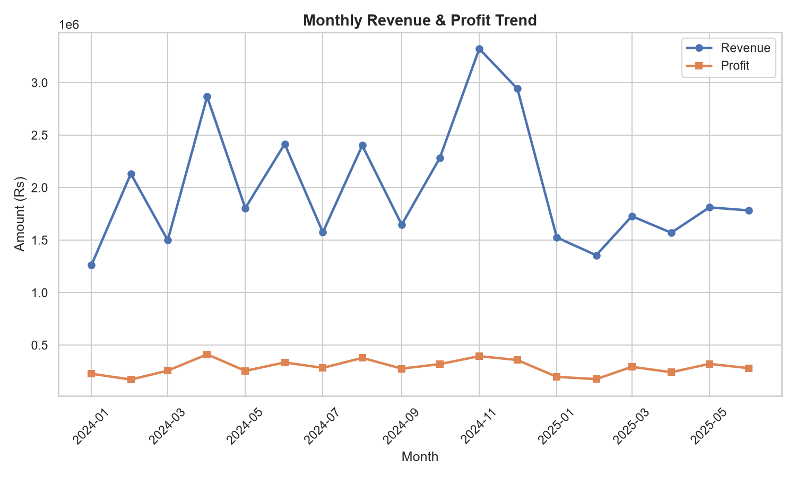
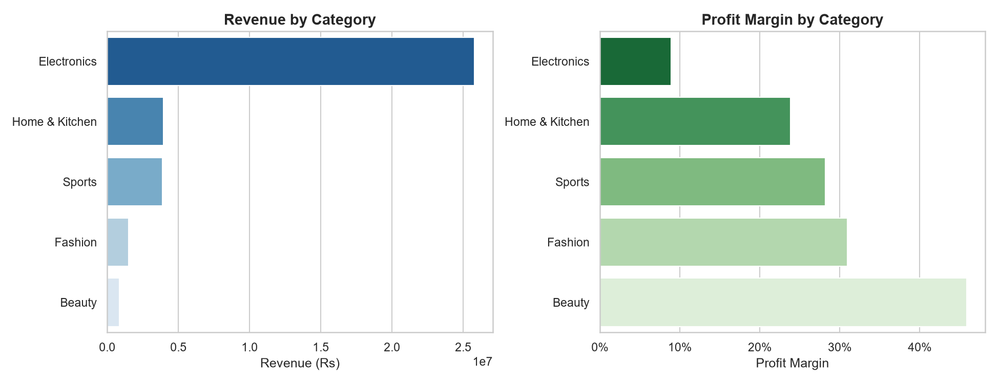
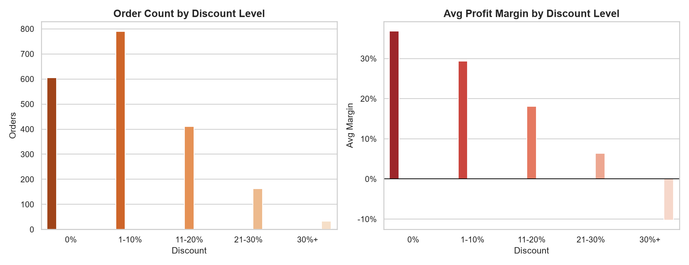
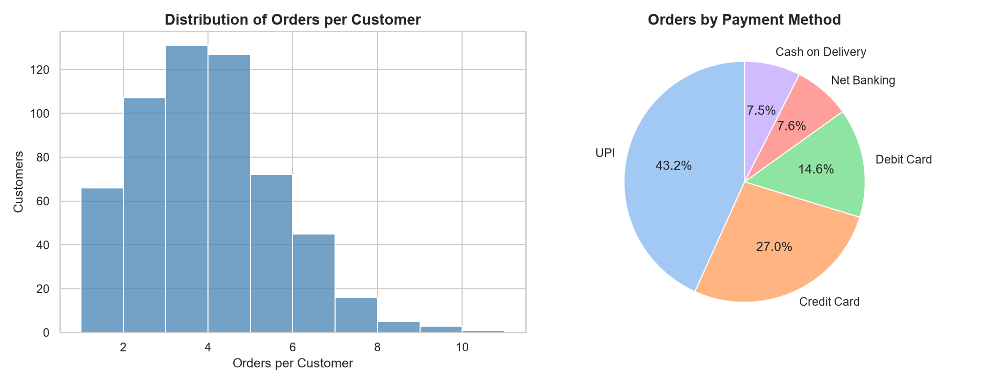
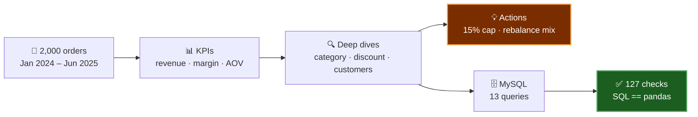

<div align="center">
  
</div>

<p align="center">
  
</p>

<p align="center">
  
  
  
  
  
  
  
</p>

> **₹3.59 crore in revenue across 2,000 orders** — and a discount policy quietly burning lakhs. This project traces every rupee: which categories earn, which discounts destroy margin, and which customers actually matter. The same findings are produced **twice** — once in pandas in the notebook, once in MySQL in `sql/` — and `sql/verify_sql.py` asserts the two agree. Explore the results in the **live Tableau dashboard** or the **Excel reporting workbook** below.

[Open Tableau Public dashboard](https://public.tableau.com/app/profile/isfaque.ansari5273/viz/Ecommerce_Sales_Executive_Overview/E-commerceSales-ExecutiveOverview) · [Tableau workbook](tableau/Ecommerce_Sales_Executive_Overview.twbx) · [Excel workbook](excel/Ecommerce_Sales_Excel_Report.xlsx)

---

## 📊 The headline numbers

| Metric | Value |
|---|---|
| Orders analyzed | 2,000 (Jan 2024 – Jun 2025) |
| Unique customers | **573** |
| Total revenue | **₹3,59,28,969** |
| Total profit / overall margin | ₹51,82,912 / **14.43%** |
| Money lost to deep discounting | **−₹2.49 lakh** across 195 orders |
| Revenue from top 10% of customers | **41.18%** |
| H1 2025 revenue vs H1 2024 | **−18.41%** |



## Tableau dashboard

**[View the interactive executive overview on Tableau Public](https://public.tableau.com/app/profile/isfaque.ansari5273/viz/Ecommerce_Sales_Executive_Overview/E-commerceSales-ExecutiveOverview)** — no local Tableau installation required.

The dashboard includes a KPI scorecard, monthly revenue and profit, category revenue versus margin, discount versus profit, regional performance, payment mix, and the top 10 products. Filter by **region** or **category**, or click a category bar to explore the order mix.

[Download the packaged Tableau workbook](tableau/Ecommerce_Sales_Executive_Overview.twbx) to inspect the seven worksheets and dashboard. The `.twbx` includes its Hyper data extract.

## Excel workbook

**[Download Ecommerce_Sales_Excel_Report.xlsx](excel/Ecommerce_Sales_Excel_Report.xlsx)**, then open it in Microsoft Excel. Start with `KPI_Dashboard` for the sales, profit, margin, order and customer totals.

| Sheet | Contents |
|---|---|
| `KPI_Dashboard` | Formula-based KPI scorecard and monthly sales summary |
| `Monthly_Trend` | Monthly orders, sales, profit and margin |
| `Category_Region` | Category and regional performance summaries |
| `Discount_Payment` | Discount-bucket and payment-method summaries |
| `Pivot_Category` | Formula-based category-by-region summary with a region selector; not a native PivotTable or slicer |
| `Quality_Checks` | Row-count, duplicate, blank-value and financial-total checks |
| `Clean_Data` | 2,000 orders with derived month, discount bucket, margin and loss-making flags |
| `Raw_Data` | The original 13 source columns for all 2,000 orders |

The raw and clean source columns match the committed `ecommerce_sales.csv`. The headline sales and profit totals are rounded to the nearest rupee; margin is profit divided by sales.

## ⚠️ Finding #1 — the margin-mix trap

Electronics drives **71.74% of revenue (₹2.58 Cr)** but only **44.39% of profit**, at an
**8.93% margin**. The business is scaling its thinnest slice. Meanwhile Beauty earns
**45.89% margin** on 2.33% of revenue. Every rupee moved from Electronics to Beauty is
worth ~37 paise of extra profit at these margins.



## 🔥 Finding #2 — discounts past 20% are a subsidy, not a promotion

Margin falls monotonically with discount depth — 36.88% at 0%, 18.04% at 11–20%, and
**−10.22% in the 30%+ bucket**. Orders discounted above 20% run at a **−8.58% blended
margin**: 195 orders, ₹29 lakh of revenue, **−₹2.49 lakh of profit**, with 63 of them
sold below cost. The fix: **cap blanket discounting at 15%**, and make the cap
category-aware.



## 📉 Finding #3 — the "growth" in that chart is a seasonal artefact

The monthly line peaks at 2024-11 and reads as momentum. Compare like-for-like halves
instead: **H1 2025 revenue is down 18.41%** (₹1.20 Cr → ₹0.98 Cr) and AOV fell 13.9%,
while margin *improved* 13.85% → 15.47%. The business is shrinking and getting healthier
at once — which is what buying volume with discount depth looks like. Note the peak month
itself: **2024-11 earns the most revenue at the second-thinnest margin of the series
(11.88%)**.

## 👑 Finding #4 — the loyal core

The **top 57 customers (10%) generate 41.18% of revenue**, **88.48% of customers reorder**,
and UPI dominates payments (43.25% of orders). Retention spend aimed at this core beats
acquisition spend aimed at everyone.



---

## ⚙️ How it works



## 📂 What's inside

```
├── Ecommerce_Sales_Analysis.ipynb  # narrated case study, 31 cells, fully executed
├── ecommerce_sales.csv             # 2,000 orders × 13 columns (committed)
├── findings.md                     # stakeholder summary + recommendations
├── requirements.txt                # pandas · numpy · matplotlib · seaborn · sqlglot · duckdb
├── sql/
│   ├── schema.sql                  # MySQL 8.0 DDL for the orders table
│   ├── load_data.sql               # LOAD DATA LOCAL INFILE + row-count sanity check
│   ├── analysis_queries.sql        # 13 MySQL queries covering the 12 analysis sections
│   └── verify_sql.py               # proves every query reproduces the notebook
├── tableau/
│   └── Ecommerce_Sales_Executive_Overview.twbx  # packaged dashboard + embedded extract
├── excel/
│   └── Ecommerce_Sales_Excel_Report.xlsx       # 8-sheet reporting workbook
└── visuals/                        # 7 charts (shown above)
```

## ▶️ Run it

```bash
pip install -r requirements.txt
jupyter notebook Ecommerce_Sales_Analysis.ipynb   # run from the repo root (the CSV path is relative)
python sql/verify_sql.py                          # 127 PASS/FAIL checks, exit 0 on green
```

## 🗄️ The MySQL layer

The notebook is the analysis; `sql/` is the same analysis the way a warehouse team would
run it. Load the CSV into MySQL 8.0 and execute the queries directly:

```bash
mysql -u root -p < sql/schema.sql
mysql --local-infile=1 -u root -p < sql/load_data.sql
mysql -u root -p ecommerce_sales < sql/analysis_queries.sql
```

| Query | Produces |
|---|---|
| Q1 | KPI dashboard — revenue, profit, margin, orders, customers, AOV |
| Q2 | Monthly revenue / profit / margin / AOV trend (18 months) |
| Q3 | Category revenue share **vs profit share** — the margin-mix trap |
| Q4 | Region revenue, orders, AOV, margin |
| Q5 | Discount buckets with per-order margin and loss-making order count |
| Q6 | Top 10 products by revenue |
| Q7 / Q7b | Repeat purchase rate · top-decile revenue concentration |
| Q8 | Payment-method mix and AOV |
| Q9 | Category × region margin heatmap (20 cells, long form) |
| Q10 | The 21%+ discount problem, quantified |
| Q11 | Like-for-like H1 2024 vs H1 2025 *(not in the notebook)* |
| Q12 | Which category the deep discounting actually destroys |

`verify_sql.py` has no MySQL server to talk to, and doesn't need one: it parses each
query with sqlglot's **MySQL dialect** (so non-MySQL syntax fails immediately), transpiles
it to **DuckDB**, runs it against the committed CSV, and asserts all 127 numbers against
what pandas computed in the notebook. Writing Q11 for the SQL layer is also what surfaced
the H1 decline the monthly chart hides — the notebook had no like-for-like comparison.

---

## 🔭 Where I'd take it next

- **Price elasticity model** — estimate demand response per category so discounts are *priced*, not guessed.
- **RFM segmentation** — recency/frequency/monetary tiers to target the 41.18% core with surgical offers.
- **Promo cannibalization analysis** — do site-wide sales steal from full-price weeks? Measure it before running the next one.
- **A/B test the 15% cap** rather than rolling it out company-wide on the strength of an observational slope.

---

*Synthetic order data with realistic retail behavior — seasonal demand, category margin structure, and discount response baked in. The CSV is committed, so every number above is reproducible without regenerating it; the pipeline and queries work unchanged on live sales data.*

<div align="center">
  
</div>
